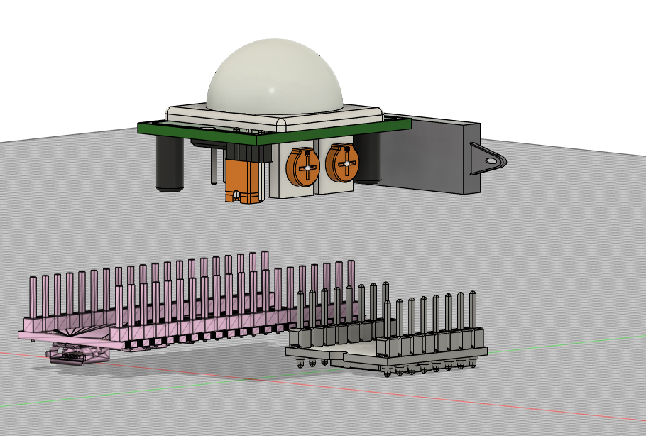
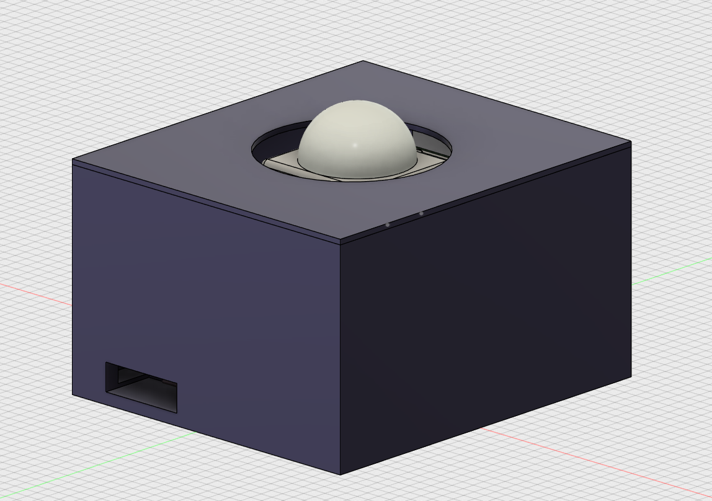
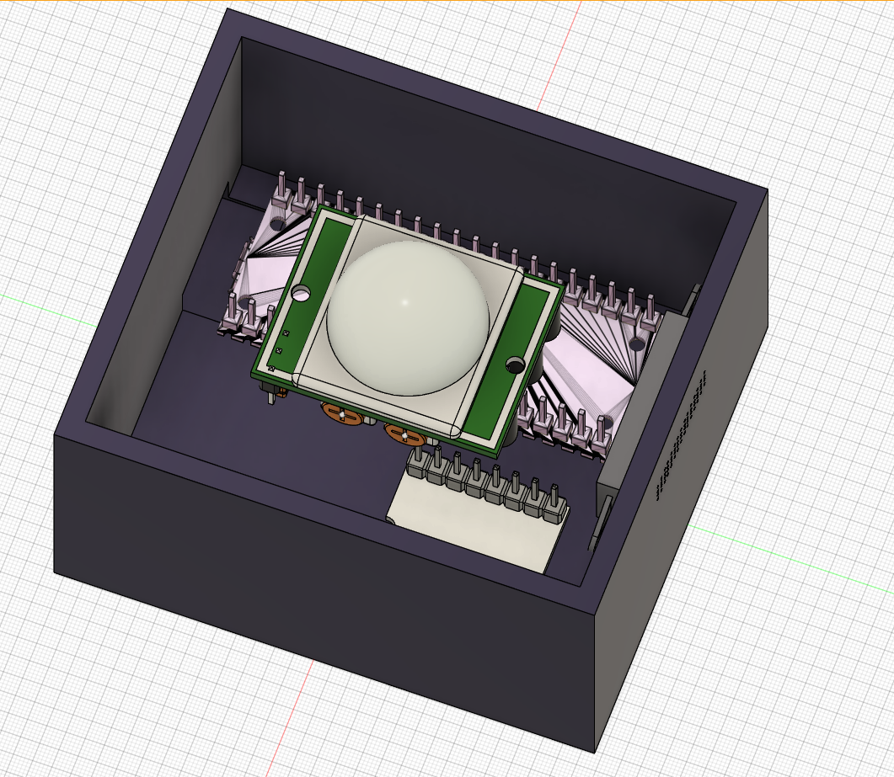
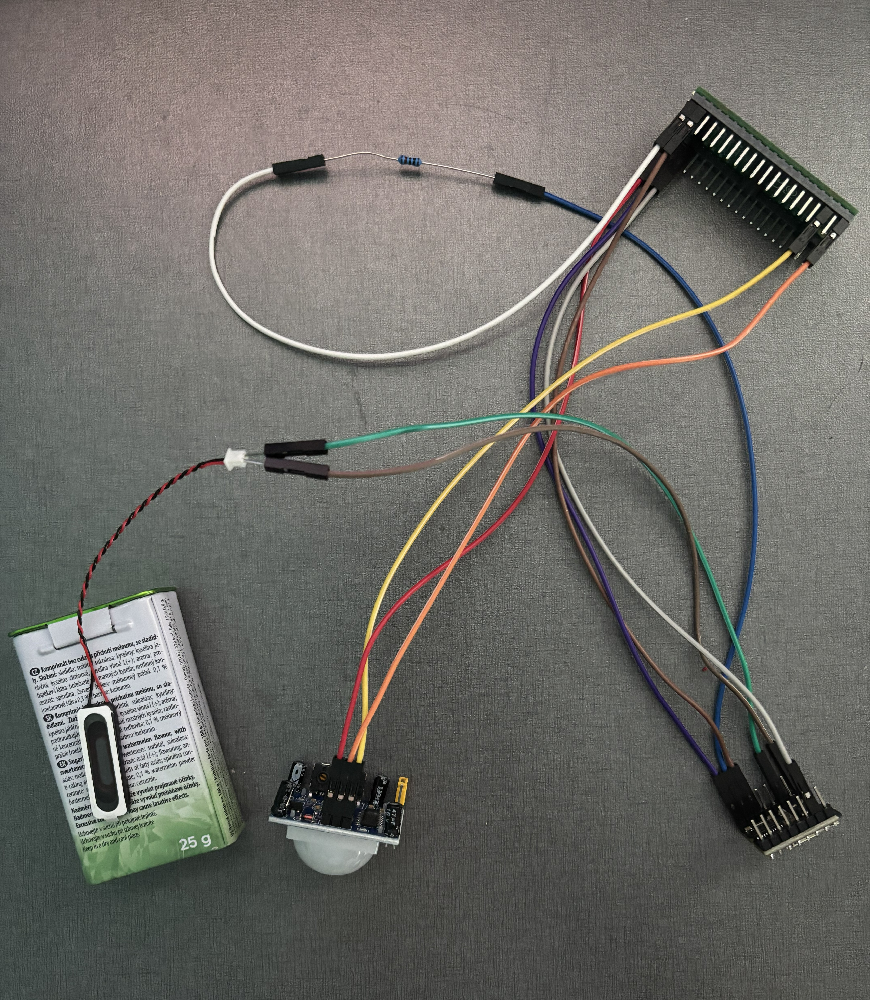
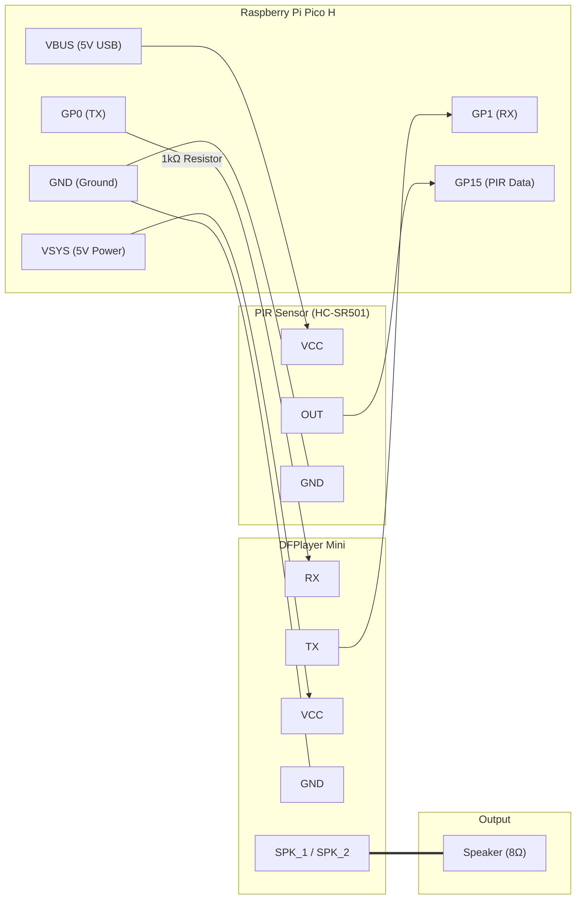

# Scary-berry speaker

## What is it?

This is a small and quick project for my family, hackclub and myself.
 
Halloween is coming up and my parents love doing a lot of scary decorations for our house. But we live in the Czech Republic and that sort of thing isn't really common.
 
Most of the "interactive" decorations that you can find in stores are cool, but always speak English (there is absolutely nothing in Czech) and so I am making this project.

### It is extremly simple!

All it is, simply put, is just a device that has a motion sensor and a speaker. When the sensor detects movement, it sends a signal to the device to play one of the few recorded sounds.

## My Idea

The goal was making it as cheap as possible, so what I came up with is this:

- The main controller is gonna be an rpi pico or some off-brand arduino
- Some movement sensor
- An mp3 player module with a MicroSD slot
- An 8 ohm speaker
- and some other stuff around
- last will be a 3D printed case for it

## BOM

So this is what I'm gonna be working with:

- Raspberry Pi Pico H
- PIR sensor HC-SR501
- DFROBOT MiniDF player Mp3 DFPlayer
- Speaker 1W 8Ω
- MicroSD card
- Breadboard 400 pin
- resistor 1kΩ
   
   

here is an image of the components without a case :)

## Intention

As I stated, it is mostly for my family, but also a good thing for me, since I've never worked with an RPI pico, it will be an amazing learning opportunity.

## Case

I modeled a case by myself for the first time in Fusion, it's not great but it will do (at least for me :D)

## TODO

Once i connect it all up here's what im hoping to do:

- [x] Put some more pictures in the README
- [x] Add a guide as to how to connect it all up (with all the pins and where to put what)
- [x]Write the python script for those who don't like C++
- [x] Edit the code so it doesn't only play the first track, but picks one at random
- [ ] Make the speaker louder
- [ ] Make better sounds (the one in the repo are very very makeshift)

## IRL look

So after I made it irl (without the box), this is what it looks like:

Everything is wired up. The speaker is a little quiet so i suggest putting it on like a can on something (i put it on a lil' candy box for now), because it has like no bass. Other than that, it works fine imo, at least for me and for our haloween decoration.

## Connections:

After you connect it all up, all you need to do is put the audiofiles on the MicroSD card like this - /01/00x.mp3 and run it with the dfplayer file on the rpi
